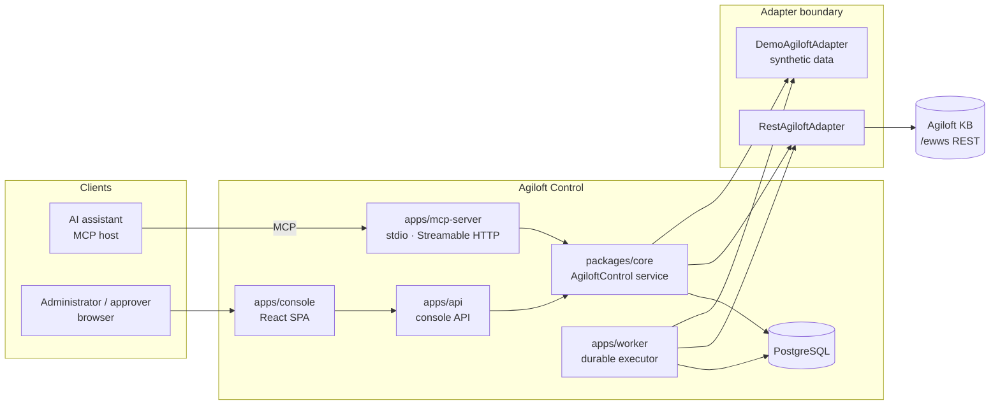
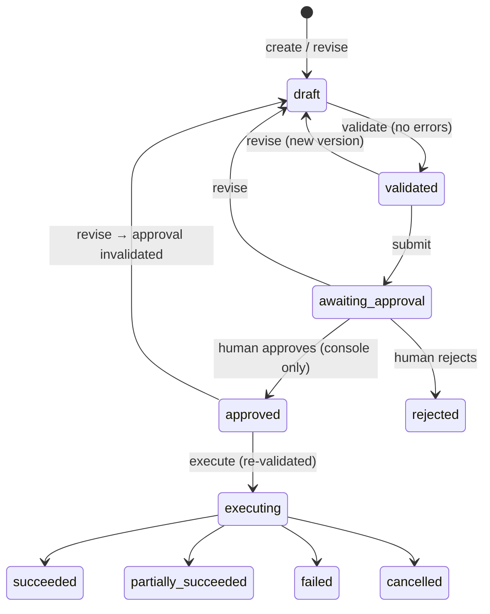
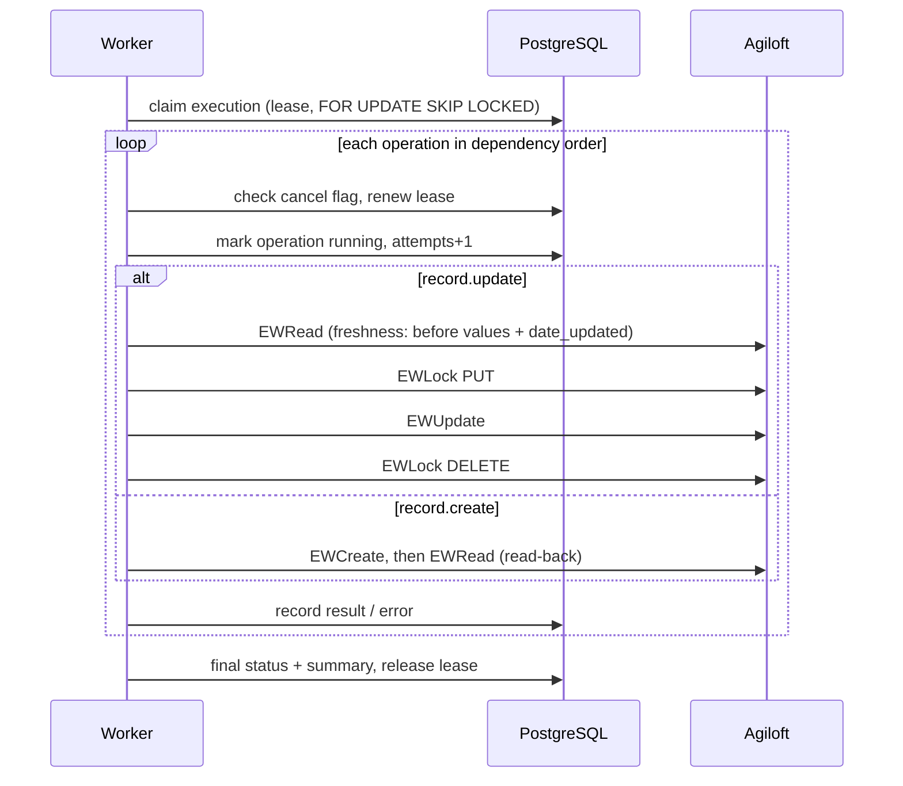

# Architecture and data flow

## Components

Responsibilities are separated as follows:

| Responsibility                               | Where                                                                                                               |
| -------------------------------------------- | ------------------------------------------------------------------------------------------------------------------- |
| Agiloft client and version-specific adapters | `packages/agiloft-client` (`RestAgiloftAdapter`, `DemoAgiloftAdapter`, `AgiloftAdapter` interface)                  |
| Capability discovery                         | `packages/capabilities` (documentation registry and gate); `RestAgiloftAdapter.verify()` (read-only instance probe) |
| Policy and authorisation                     | `packages/core/src/principal.ts`, `services/policies.ts`, `control.ts`                                              |
| Change planning and validation               | `packages/change-planner` (pure, deterministic)                                                                     |
| Change execution                             | `packages/core/src/services/executions.ts` (request) and `engine.ts` (durable worker)                               |
| MCP interface                                | `apps/mcp-server`                                                                                                   |
| Web console                                  | `apps/api` and `apps/console`                                                                                       |
| Background execution                         | `ExecutionEngine`, run embedded in the API (`WORKER_EMBEDDED=true`) or as `apps/worker`                             |

**One entry point.** The MCP tools and the console routes both call `AgiloftControl` (`packages/core/src/control.ts`). Authorisation, policy checks, approval binding and audit logging live there, never in the transport layers, so both paths are identical.

**Mocking stops at the adapter.** Demo mode swaps only `AgiloftAdapter`. Everything above it (policy, approvals, the engine, audit) runs unchanged. A live connection always gets the live adapter; if it fails, it fails, and demo data is never substituted.

## Request flow: reading data

1. The caller is authenticated (console session, stdio user, or a verified OAuth bearer token) and resolved server-side to a `Principal` with roles from the database.
2. `AgiloftControl` checks the permission for the connection's environment. For MCP it also checks the token scope.
3. Structured filters are compiled into the **documented** EWSearch syntax (`=`, `!=`, `~=`, `<`, `<=`, `>`, `>=`, `&&`, `||`, single-quoted values, `null`). Anything the documentation does not describe is rejected rather than guessed; for example, there is no documented escape for a single quote.
4. The adapter sends a POST form request with a bearer token to `/ewws/EWSearch/.json`. Credentials and record data never appear in URLs.
5. Results are bounded: the page size is capped at 100, long strings are truncated, and responses are capped at about 256 KB.
6. MCP responses wrap record content in an explicit **untrusted data** envelope.

## Change flow

- **Versioning and hashing.** Each plan version stores its content and a SHA-256 hash of the canonical JSON. The approval row stores `plan_version`, `plan_hash`, `connection_id`, `environment`, `decided_by`, `reason` and `expires_at`.
- **Approval.** The approver must submit the version and hash they reviewed. If the plan changed, the server answers `PLAN_CHANGED`. Separation of duties is enforced server-side: the creator, the submitter and the author of the current version cannot approve.
- **Execution request.** The server recomputes the hash from the stored content. It re-checks the approval binding, expiry and invalidation, the connection's environment and the current policy, and it **re-validates the plan against the live schema** before queuing. One execution per plan version is enforced by a unique index.
- **Capability evidence** in a plan is always computed by the server from the operations themselves. Evidence supplied by a caller is ignored.

## Execution engine

Failure handling distinguishes three outcomes reported by the adapter (`AgiloftError.writeOutcome`):

| Outcome    | Example                                             | Engine behaviour                                                                                                                                                                                                                                                    |
| ---------- | --------------------------------------------------- | ------------------------------------------------------------------------------------------------------------------------------------------------------------------------------------------------------------------------------------------------------------------- |
| `not_sent` | DNS failure, connection refused, 429                | Bounded retry with backoff (3 attempts in total)                                                                                                                                                                                                                    |
| `rejected` | 4xx validation, permission                          | Operation fails; later operations are skipped                                                                                                                                                                                                                       |
| `unknown`  | Timeout after the body was sent, 5xx, lost response | **Reconcile by reading** before anything else: a create is matched by its `reconcileBy` unique field, an update by comparing current values with the before and after values. If still undetermined, the status is `unknown` and the engine stops for manual review |

**Restart recovery.** An operation found in state `running` when a worker claims an expired lease is _in doubt_, because the previous worker died mid-call. It is reconciled first, never blindly repeated.

**Graceful shutdown.** The worker finishes the current operation, releases its lease and leaves the remaining operations to the next worker.

**Manual steps.** Operations with kind `manual.configure` or `external.orchestrate` are recorded as `manual`, with their instructions, and are never executed. Validation forbids an automated operation from depending on a manual one.

**No rollback.** Agiloft has no cross-call transaction, so nothing is rolled back. Plans declare compensating actions (manual), and the execution summary gives recovery guidance.

## Identity model

| Layer           | Identity                                                                                           |
| --------------- | -------------------------------------------------------------------------------------------------- |
| Console         | Individual user (OIDC, or the development login outside production)                                |
| Remote MCP      | Individual user mapped from the token subject (`<issuer>\|`); roles come from Agiloft Control |
| Local stdio MCP | The Agiloft Control user named by `MCP_STDIO_USER_EMAIL`                                           |
| Agiloft         | **Shared integration identity** of the connection (login token or OAuth client credentials)        |

Agiloft history therefore shows the integration user, not the individual. The Agiloft Control audit log records the individual who prepared, approved and executed each plan, with plan ID, version and hash. Client tokens are never forwarded to Agiloft. The Agiloft OAuth authorization-code flow binds permissions to a configured Contact ID, so it would not by itself provide per-user identity either; see the roadmap.

## Data model

Defined in `packages/core/src/db/migrations.ts`:

- `users`, `role_assignments` (role per environment or `*`), `sessions` (only SHA-256 of the session token is stored)
- `connections` (AES-256-GCM sealed credentials bound to the connection ID), `environment_policies`
- `plans`, `plan_versions` (content and hash), `approvals`
- `executions` (lease columns, one per plan version), `execution_operations`, `execution_events`
- `audit_events` (redacted details)
- `demo_records`, `demo_faults` (storage behind the demo adapter)

All timestamps are `timestamptz` and stored in UTC. The console formats them in the viewer's locale and time zone.

## Scenario planning

1. Text is interpreted into `StructuredRequirements` (`packages/change-planner/src/requirements.ts`) by one of:
   - the deterministic parser,
   - the structured form,
   - structured input from an MCP client,
   - optionally, the Anthropic model adapter (`MODEL_PROVIDER=anthropic`). It receives only the scenario text, and its output is schema-validated.
2. `analyseScenario` maps the requirements onto tables discovered on the connection. It never invents approver fields, relationships or calendars; missing information becomes an explicit **unknown**, which can be blocking or non-blocking.
3. Each of the 13 planning categories is classified into an implementation route: `native_existing`, `config_records`, `admin_api`, `external_orchestration`, `manual_admin` or `unsupported`.
4. Only `config_records` steps against tables that exist on the KB become executable record operations. Rules, notifications, escalations and permissions become manual steps that reference the Rules wizard. External orchestration is never substituted silently.
